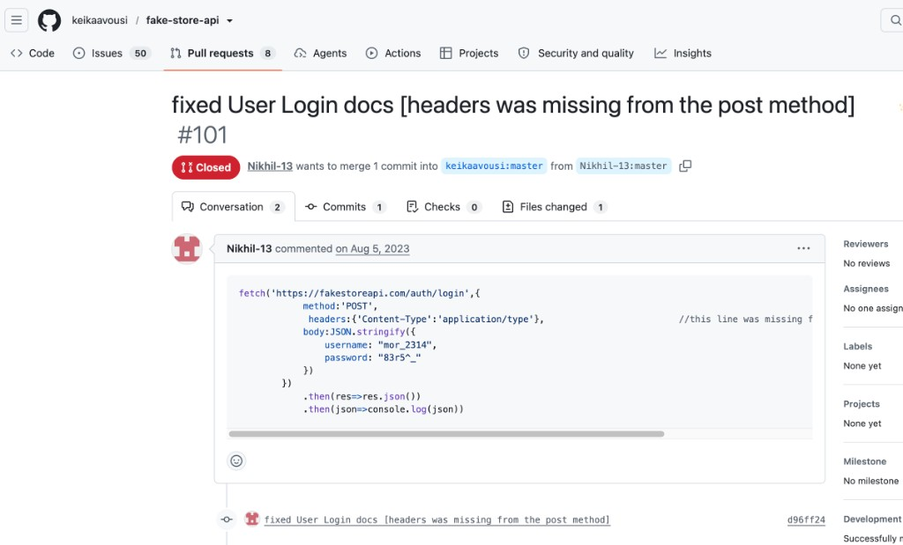
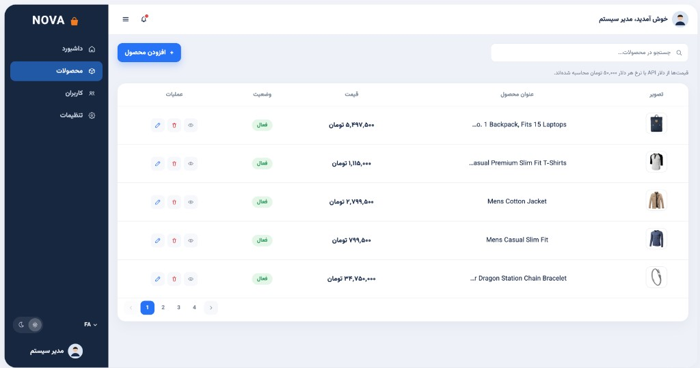
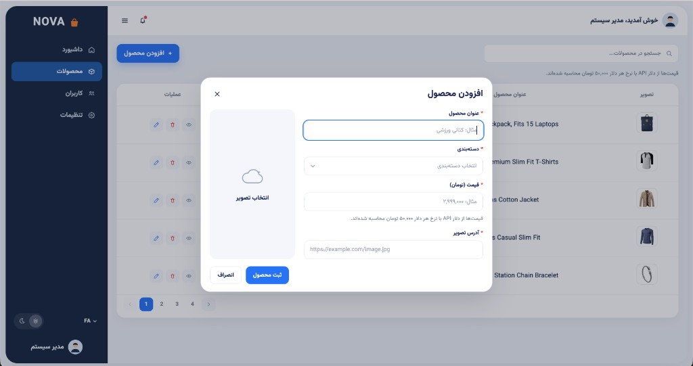
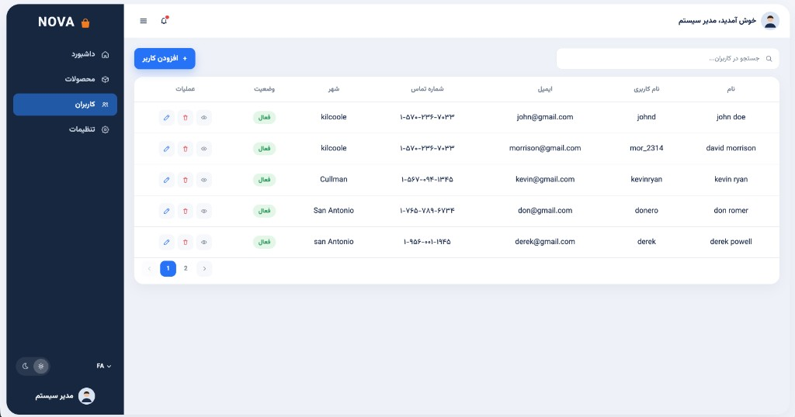
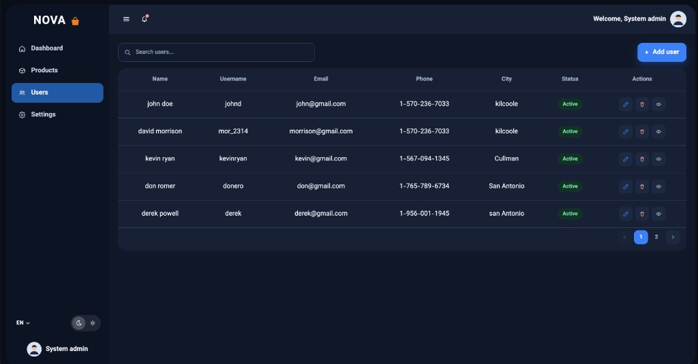
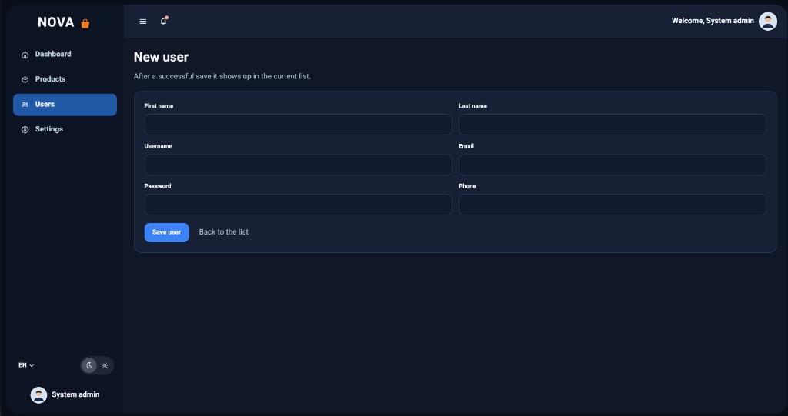

# NOVA Admin

پنل مدیریت فروشگاه NOVA. با Vite و React نوشته شده و به [FakeStoreAPI](https://fakestoreapi.com) وصل است.

## اجرا

Node 20 یا جدیدتر.

```bash
npm install
cp .env.example .env
npm run dev
```

روی `http://localhost:5173` بالا می‌آید. برای بیلد: `npm run build`.

ورود با `POST /auth/login` انجام می‌شود و توکن پاسخ ذخیره می‌شود. رمز داخل کد و env نیست. حساب آزمایشی همان نمونه‌ای است که در [مستندات FakeStoreAPI](https://github.com/keikaavousi/fake-store-api/pull/101) آمده:



## صفحه‌ها

فهرست محصولات، با قیمت تومان و صفحه‌بندی.



مودال افزودن محصول.



فهرست کاربران.



همان فهرست با زبان انگلیسی و تم تیره.



فرم کاربر جدید.



## چی کجاست

ساختار پوشه‌ها همان چیزی است که توی سند خواسته شده بود.

- `Pages` صفحه‌ها هستند، `Components` فرم‌های همان صفحه‌ها.
- `Shared` چیزهای تکراری مثل دکمه، اینپوت، جدول و layout.
- `Dictionary` متن فارسی و انگلیسی. توی JSX متن ثابت ننوشتم.
- `Redux` وضعیت ورود، محصول، کاربر، زبان و تم.
- `Utils/api` همان AxiosInstance است و بقیهٔ درخواست‌ها توی `Utils/services`.
- `Storage` خواندن و نوشتن localStorage.
- `Validations` اسکیمای Yup.
- `Modals` مودال تأیید خروج.
- `Routes` تعریف مسیرها و گارد صفحه.

`useState` را برای چیزهای محلی گذاشتم: جستجو، باز بودن مودال، پیام موفقیت فرم.

## تم و زبان

هر دو توی ریداکس هستند و توی localStorage می‌مانند. زبان جهت متن را عوض می‌کند. سایدبار، مثل طرح، سمت چپ می‌ماند.

## API

آدرس از `VITE_API_BASE_URL` خوانده می‌شود.

FakeStoreAPI واقعاً چیزی را ذخیره نمی‌کند. بعد از POST موفق، آیتم را به لیست همین نشست اضافه می‌کنم. با رفرش از بین می‌رود. idای که API برای محصول جدید برمی‌گرداند تکراری است، برای همین اگر id قبلاً توی لیست باشد یکی محلی می‌سازم که ردیف‌ها قاطی نشوند.

قیمت API دلار است. نرخ تبدیل از `VITE_USD_TO_TOMAN` خوانده می‌شود و اگر نباشد ۵۰ هزار تومان برای هر دلار است. فرم و جدول تومان‌اند؛ موقع ثبت دوباره به دلار برمی‌گردد. همان نرخ در فروشگاه هم هست و روی صفحه نوشته شده. اگر API پاسخ ۴۰۱ بدهد، نشست پاک می‌شود.

صفحه‌بندی API واقعی ندارد. فهرست محصول و کاربر سمت کلاینت صفحه‌بندی می‌شود، هر صفحه ۵ ردیف. جستجو هم روی همان لیست است و با جستجوی جدید به صفحهٔ اول برمی‌گردد.

توکن `POST /auth/login` را در localStorage می‌گذارم. سند گفته بود برای توکن کوکی HttpOnly بهتر است، ولی اینجا بک‌اند خودمان نداریم که کوکی ست کند. رمز را هیچ‌جا ذخیره نمی‌کنم و در باندل هم نیست.

## خارج از محدوده

ویرایش و حذف فقط فهرست همین نشست را عوض می‌کند؛ FakeStoreAPI آن را نگه نمی‌دارد. داشبورد شمارنده‌ی همین دیتا است.

قالب Vite فلگ `erasableSyntaxOnly` را روشن کرده بود و با enum تداخل داشت. خاموشش کردم تا enumهای سند قابل استفاده باشند. `baseUrl` هم در TypeScript این قالب حذف شده، برای همین alias را فقط با `paths` گذاشتم.
